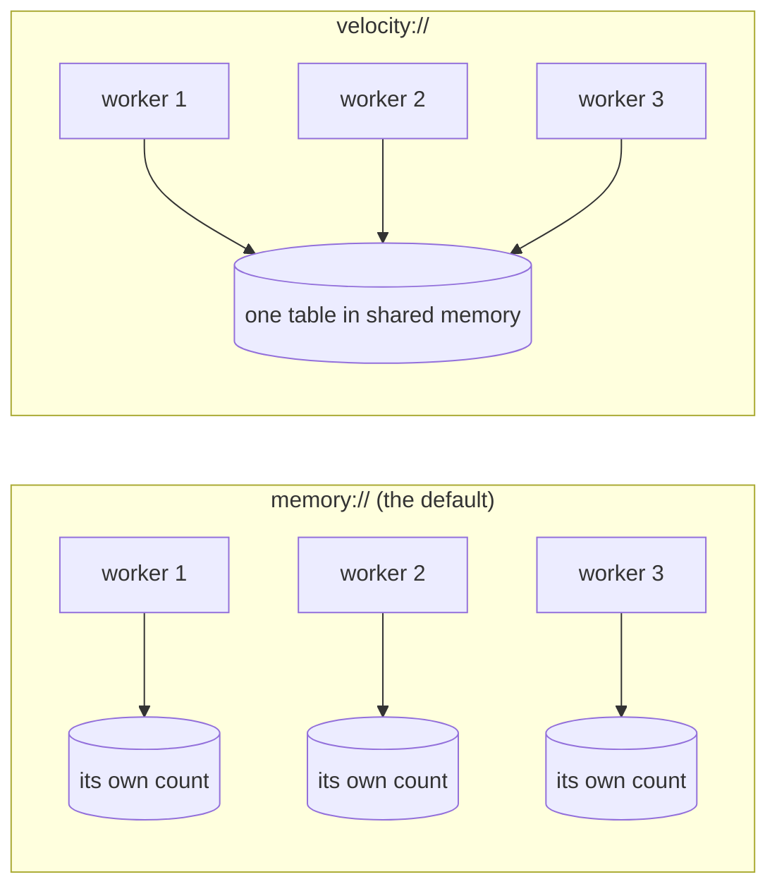

# velocity-limits

[](https://github.com/linkanlabs-ctrl/velocity-limits/actions/workflows/tests.yml)

**Rate limits that every worker on your server shares exactly, with no Redis to run.**

Flask-Limiter and slowapi keep their counts in `memory://` unless you configure a storage. Under
gunicorn or uvicorn every worker process then counts on its own, so **4 workers let through 4
times your limit.** Flask-Limiter's maintainer explains it the same way: a limit of
"1/hour/user" spread across n worker processes ends up meaning about "n/hour/user"
([discussion #373](https://github.com/alisaifee/flask-limiter/discussions/373)).

velocity-limits gives all your workers one shared count in shared memory. It is exact like Redis,
**up to 100x faster per check**, and has nothing extra to run. Switching takes one import and one
changed URI:

```python
import velocity_limits                     # registers the velocity:// storage

# Flask-Limiter
limiter = Limiter(get_remote_address, app=app, storage_uri="velocity://myapp")
# slowapi (FastAPI, Starlette)
limiter = Limiter(key_func=get_remote_address, storage_uri="velocity://myapp")
```

## At a glance
| | default `memory://` | Redis | **`velocity://`** |
|---|---|---|---|
| 4 workers, limit 100: requests let through | **400** (wrong) | 100 | **100** |
| One check through `limits` | 3.3–5.3 µs | 178–310 µs | **1.7–2.6 µs** (105–120x faster) |
| 8 workers checking at once | not measured | 17.9–18.7 k checks/s | **2.3–4.1 M checks/s** (126–218x) |
| Extra server to run and secure | no | yes | **no** |

These are measured numbers from two runs: Linux under WSL2 on an i7-13700H, Python 3.12, with
Redis on the same machine. The raw output is in [benchmarks/results/](benchmarks/results/). On
native Linux the loopback to Redis is faster, so Redis looks better there than it does here.

## Install
Wheels are built for CPython 3.10–3.14 on:
- Linux x86-64 and ARM64, glibc and musl (Alpine);
- macOS Intel and Apple Silicon;
- Windows x64.

```
pip install "velocity-limits[limits]" --find-links https://github.com/linkanlabs-ctrl/velocity-limits/releases/expanded_assets/v0.1.0
```

It is not on PyPI yet. Until then the wheels are on the [Releases page](https://github.com/linkanlabs-ctrl/velocity-limits/releases),
with their SHA-256 checksums.

## See it on your own machine
```
python -m velocity_limits.demo                       # add --redis redis://localhost:6379 to compare
```
The demo starts 4 independent worker processes, the way gunicorn and uvicorn start theirs. They
share one limit of 100 requests per minute, and receive 1,000 requests from one client:
```
  storage       let through  should be  time per check
  memory://             400        100          4.5 µs   WRONG: each worker counts alone
  velocity://           100        100          3.7 µs   one count, shared by all 4
  redis://              100        100        465.3 µs   one count, over the network
```
Options: `--workers`, `--requests`, `--limit`.

With real servers, [benchmarks/web_demo.py](benchmarks/web_demo.py) runs Flask-Limiter on gunicorn
and slowapi on uvicorn, 4 workers each, against 1,000 requests. On `memory://` both let 400
through; on `velocity://` both let exactly 100 through
([results](benchmarks/results/web_demo.txt)).

## How it works

- **One table, mapped by every worker.** The table is a file that each worker maps into memory:
  in `/dev/shm` (RAM) on Linux, and in the temp directory on macOS and Windows. A worker that
  opens `velocity://myapp` finds the table by its name, however the worker was started.
- **One atomic step per count.** Each key lives in a 16-byte slot that holds its hash, its count
  and when its window ends. A check is a single 16-byte compare-and-swap, so there are no locks
  on the hot path. A worker killed at any instruction never leaves a slot half-written.
- **Keys hashed with a secret.** Keys go through SipHash with a random secret made for each table,
  so clients cannot pick keys that collide with someone else's.
- **Each new key is inserted once.** Striped locks cover inserts, so workers that see the same new
  client at the same moment add it once. If a lock holder dies, or holds a lock for more than a
  second, another worker takes the lock over.
- **No cleanup job.** A slot whose window has ended is reused for new keys.

## Use it without `limits`
```python
from velocity_limits import SharedTable

t = SharedTable("myapp")              # 65,536 keys by default; SharedTable("myapp", capacity=2**20)
t.incr("client-1", 60)                # count in this key's 60-second window, after adding 1
t.incr("client-1", 60, amount=5)      # add 5
t.get("client-1"), t.get_expiry("client-1"), t.clear("client-1")
```

## Tested in public
[tests/test_limits_table.py](tests/test_limits_table.py) holds the full suite of 25 tests. They
cover:
- the window semantics, with answers identical to `limits`' own MemoryStorage over 3,000 random
  operations;
- exact counts from independently started interpreters;
- 6 processes inserting the same 1,500 new keys at once, each key inserted exactly once;
- a full table, and slot reuse after a window ends;
- lock takeover from a dead process and from a stalled one;
- workers killed in the middle of an update 30 times, after which the table still works;
- the demo itself.

The [tests workflow](.github/workflows/tests.yml) installs the **published wheels** and runs the
suite and the demo on 25 combinations: Linux x86-64, Linux ARM64, macOS Apple Silicon, macOS
Intel and Windows, each on Python 3.10–3.14. Before release, each of the 35 wheels also passed the
suite once installed.

## Limits
- **One machine.** Workers on one server share a table. Several servers need Redis.
- **Fixed window only.** Moving and sliding windows are not supported yet.
- **Capacity.** The default table holds 65,536 keys with a live window, in about 1 MB. Keep
  `capacity` (`velocity://myapp?capacity=N`, a power of two) at least twice the number of keys live
  at once. Past that, `incr` raises `velocity_limits.TableFull`, which arrives as `limits`'
  `StorageError` with `wrap_exceptions=True`.
- **Size.** A key can count at most 67,108,863 hits per window, and a table lasts 8.7 years.
- **Where counts live.** The table file is kept until `velocity_limits.remove("myapp")`, or until a
  reboot on Linux. Counts survive restarts and deploys, but not a reboot of a Linux server.
- **Not supported:** free-threaded Python, and 32-bit platforms.

## Questions
**Why not just run Redis?**
- Redis is free, and it is the right choice when you have more than one server.
- On one server, velocity-limits needs no extra service to install, secure and monitor.
- It also saves the network round trip on every check, 175–305 µs in the measurements above.
- And it is correct in the setup where the default, `memory://`, is not.

**Is the source code available?**
- No. The engine is closed source, and the wheels are free to use under the [licence](LICENSE.txt).
- This repository has the documentation, the complete test suite and the benchmarks. Its tests run
  against the published wheels on every push, so every claim here can be checked without the
  source.

**Can I trust a compiled binary?**
- The extension makes no network connections.
- It creates its table file with permissions 0600, so on Linux and macOS only your user can read
  it.
- The wheels are built with the standard Python tooling: cibuildwheel, auditwheel, delocate and
  delvewheel.
- Each release lists SHA-256 checksums for every wheel.

**What about Django, or other frameworks?**
- Anything that uses the [`limits`](https://github.com/alisaifee/limits) library gets
  `velocity://` with the import above.
- For anything else, use `SharedTable` directly.

## Pro edition (planned)
These would be paid features for teams, on top of the free version:
- quotas that survive a reboot, such as daily and monthly limits per API key and per plan;
- usage export per key, for billing and reports;
- moving and sliding windows;
- metrics for blocked requests and top keys;
- email support.

If your team would use it, [open an issue](https://github.com/linkanlabs-ctrl/velocity-limits/issues)
saying which features matter to you, or write to linkanlabs@gmail.com.

## Licence
Free to use for any purpose, commercial use included. You may redistribute unmodified wheels, for
example in your own container images or package mirrors. You may not modify the software, reverse
engineer it, or sell it on its own. The full terms are in [LICENSE.txt](LICENSE.txt).

© 2026 Linkan Labs
